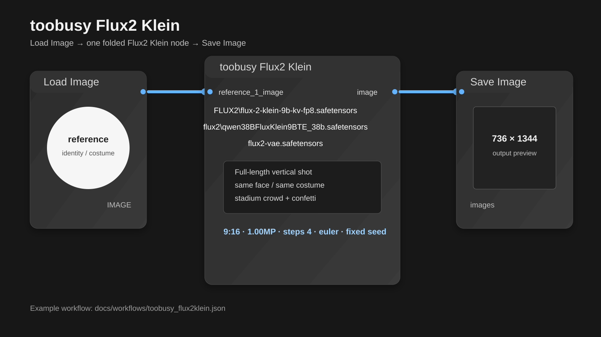
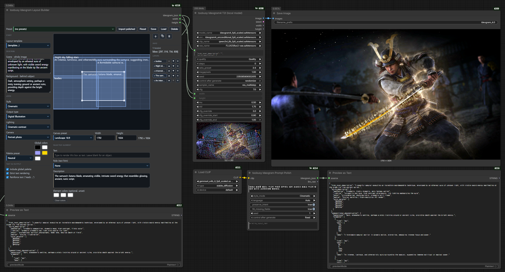
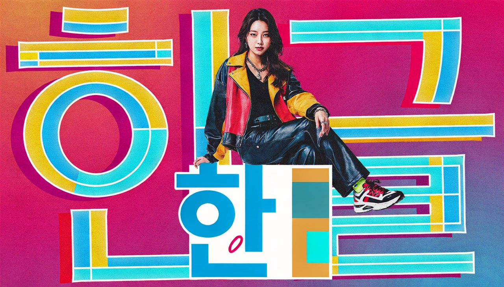
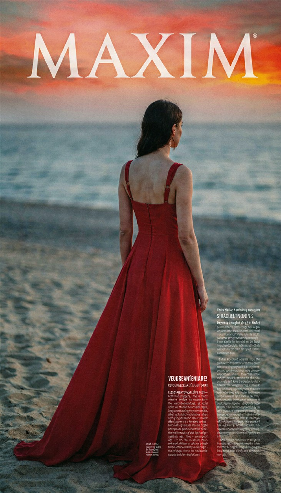
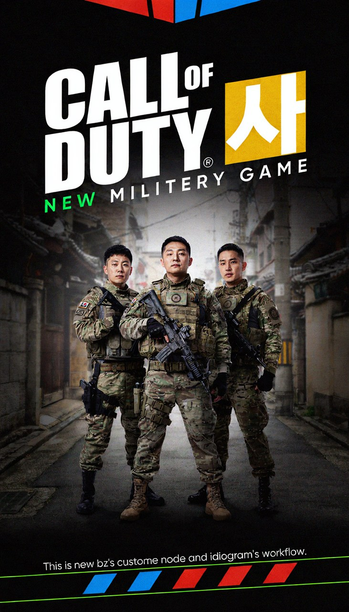
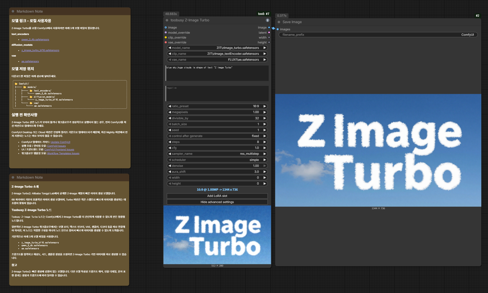

# toobusy · 너무바쁜베짱이

**번거로운 여러 단계를 노드 하나로 접어버리는** ComfyUI 커스텀 노드 모음입니다.  
여러 노드를 일일이 배선하기 귀찮은 사람을 위해, 한 노드가 체인 전체를 삼킵니다.

> **Fold the graph.** — toobusy folds tedious multi-step ComfyUI workflows into single production nodes.

현재 문서는 **v0.4.11** 기준입니다.

## Quick Start

```bash
cd ComfyUI/custom_nodes
git clone https://github.com/nicekriss/toobusy.git toobusy
```

업데이트:

```bash
cd ComfyUI/custom_nodes/toobusy
git pull
```

ComfyUI를 재시작하세요. 프런트엔드(JS) 변경을 받은 뒤에는 브라우저를 강력 새로고침(hard refresh) 하는 것을 권장합니다.

> **ComfyUI Manager로 설치할 때 주의.** Manager는 Comfy Registry에 올라간 버전을 받아옵니다.
> 지금은 0.4.9 / 0.4.10이 레지스트리에서 내려가 있어서 Manager로 설치하면 **0.4.8**이 깔리고,
> 0.4.9에서 추가된 MiniMax H3 캐릭터시트 노드들이 노드 목록에 나오지 않습니다.
> 설치는 성공하고 다른 노드도 정상 동작하므로 원인을 찾기 어렵습니다.
> 최신 노드가 필요하면 위의 `git clone`을 쓰거나 Manager의 **Install via Git URL**에
> `https://github.com/nicekriss/toobusy` 를 넣으세요.

### MiniMax H3 Single-Image Editing

`toobusy MiniMax H3 Image Latent`는 공식 H3 노드가 아직 만들지 못하는
T=1 영상+오디오 latent를 생성합니다. ComfyUI 코어 파일을 수정하거나
일반 `Empty Latent Image`를 연결하지 않고, MiniMax H3 Ref2V 모델과
[MiniMax H3 Image VAE](https://huggingface.co/Mamad8/MiniMax-H3-Image-VAE)를
정지 이미지 편집에 사용할 수 있습니다.

```text
width / height
-> toobusy MiniMax H3 Image Latent
-> SamplerCustomAdvanced
-> VAE Decode (MiniMax H3 Image VAE)
```

- H3의 `MODEL`, `CONDITIONING`, sampler, scheduler는 기존 ComfyUI 네이티브 노드를 그대로 사용합니다.
- 이 노드는 batch 1, 단일 프레임 전용입니다. 영상 생성에는 공식 `Empty MiniMax H3 AV Latent`를 사용하세요.
- 일반 `Empty Latent Image`는 H3가 요구하는 영상+오디오 `NestedTensor`가 아니므로 호환되지 않습니다.
- 검증 예제: [`minimax_h3_single_image_6edit.json`](docs/workflows/minimax_h3_single_image_6edit.json)

### MiniMax H3 Character-Sheet References

캐릭터시트 워크플로우는 얼굴과 의상을 먼저 3-view 캐릭터로 확정한 뒤,
그 결과를 두 번째 H3 패스의 포즈·소품 패널 기준으로 사용합니다.

- `toobusy MiniMax H3 Optional Reference`: 꺼진 선택 레퍼런스의 이미지 브랜치를 실행하지 않습니다.
- `toobusy MiniMax H3 Semantic Reference`: Gemma 분석의 의미 설명은 유지하면서 안전하다고 판정된 이미지만 H3에 전달합니다.
- `toobusy MiniMax H3 Reference Manifest`: 실제로 전달된 이미지에 맞춰 `<Picture N>` 번호와 역할 문장을 압축합니다.
- 예제: [`2BZ_H3_character_sheet_2stage_v1.json`](docs/workflows/2BZ_H3_character_sheet_2stage_v1.json)

### SeedVR2 Retouch — 아무 이미지나, VRAM에 맞춰

AI 이미지의 플라스틱 같은 피부·뭉개진 머리카락·옷감에 **미세 질감만** 입힙니다. 형태·얼굴·색은 원본 그대로이고 프롬프트가 없습니다.
사진 한 장이든 18MP 캐릭터 시트든 그대로 넣으면 됩니다.

```
Load Image ─ 2BZ SeedVR2 Tile Restore ─┬─ 2BZ Retouch Blend (높음 1.25 / 피부 1.0) ─ Save
           └ 2MP로 축소 ─ SAM3 Detect("skin:8") ─┴─ 2BZ Retouch Blend (낮음 1.0 / 피부 0.9) ─ Save
```

- `2BZ SeedVR2 Tile Restore`: 타일마다 자기 조건으로 SeedVR2 1스텝 복원 → 페더링해 이어 붙여 입력 크기로. `tile_megapixels`(기본 2)가 VRAM 손잡이 — 8GB 1 / 12GB 1.5~2 / 16GB 2~3 / 24GB 3~4. `upscale_small_to`(기본 3MP)보다 작은 이미지는 키워서 복원 후 원래 크기로.
- `2BZ Retouch Blend (skin-aware)`: 주파수 합성(원본 저주파 + 복원 고주파×세기), 피부 마스크 안은 따로 약하게. 마스크 키우기·페더 포함.
- 실측(RTX 3090, 3B int8, 결과 2장 포함): 2MP 사진 24초, 18MP 캐릭터 시트 79초(타일 15장), VRAM 최고치는 크기와 무관하게 약 7GB.
- 모델: [seedvr2_3b_int8_convrot](https://huggingface.co/Comfy-Org/SeedVR2/resolve/main/diffusion_models/seedvr2_3b_int8_convrot.safetensors) → `diffusion_models`, [seedvr2_ema_vae_fp16](https://huggingface.co/Comfy-Org/SeedVR2/resolve/main/vae/seedvr2_ema_vae_fp16.safetensors) → `vae`, [sam3.1_multiplex_fp16](https://huggingface.co/Comfy-Org/sam3.1/resolve/main/checkpoints/sam3.1_multiplex_fp16.safetensors) → `checkpoints`. SeedVR2·SAM3 노드는 ComfyUI 코어.
- 예제: [`2BZ_SeedVR2_Retouch_AnySize.json`](docs/workflows/2BZ_SeedVR2_Retouch_AnySize.json)

#### VOSR 2.0 엔진판 — 작은 얼굴까지 그대로 (권장)

같은 `2BZ Retouch Blend`에 복원 엔진만 [VOSR 2.0](https://github.com/cswry/VOSR)(1스텝 1.4B 초해상도, Apache 2.0)으로 바꾼 판입니다.
캐릭터 시트·단체컷처럼 얼굴이 작을 때 SeedVR2는 얼굴 인상을 바꾸는 경우가 있는데(폭 50~100px 얼굴 유사도 0.41~0.82), VOSR2는 0.94~0.99로 유지합니다(2BZ 실측 7장면).

```
Load Image ─ 작업 크기 4MP로 맞춤 ─ VOSR 2.0 Upscale ×2 ─┬─ 2BZ Retouch Blend (높음 1.6 / 피부 1.4) ─ Save
           └ 2MP로 축소 ─ SAM3 Detect("skin:8") ───────┴─ 2BZ Retouch Blend (낮음 1.25 / 피부 1.0) ─ Save
```

- 필요한 노드: **VOSR 2.0** (`comfyui-vosr2`, Manager에서 검색) + toobusy 0.5.4 이상. 모델(약 7GB)은 첫 실행 때 자동으로 받습니다.
- 손잡이: 작업 크기(기본 4MP, 18MP 시트는 6), VRAM은 `vae_tile_size`(기본 512 → VOSR2 사용량 약 5.3GB).
- 실측(RTX 3090, 모델 로딩 포함): 2MP 사진 74초(두 번째부터 57초), 18.7MP 시트 85초, VRAM 최고치 약 9GB(SAM3·대기 포함). SeedVR2판보다 약 3배 느립니다.
- 예제: [`2BZ_VOSR2_Retouch_AnySize.json`](docs/workflows/2BZ_VOSR2_Retouch_AnySize.json)
- **크게 키우는 게 목적이면** 업스케일판 [`2BZ_VOSR2_Upscale.json`](docs/workflows/2BZ_VOSR2_Upscale.json): Load Image → VOSR 2.0 Upscale(`upscale` = 배율, 기본 4) → Save. 리터치판과 달리 결과가 입력 × 배율 크기로 저장됩니다. 원본을 1/4로 줄였다가 ×4로 되돌린 실측에서 일반 확대보다 주름·수염이 확실히 살아남(선명도 0.31→0.56), 3090에서 1~2MP 출력 6~11초.

### Detection → per-box detail pass (Qwen-Image 2.1 등)

큰 이미지에서 **찾을 것을 텍스트로 검출 → 박스마다 따로 2K로 다시 그림 → 줄여서 제자리에 페더링 복귀.** 좌표 입력이 없습니다.

```
Load Image ─ SAM3 Detect("person:8") ─ 2BZ Crop Each BBox (list) ─ TextEncodeQwenImage21 / VAEEncode ─ KSampler ─ VAEDecode ─ 2BZ Paste Crops Back ─ Save
```

- `2BZ Crop Each BBox (list)`: 박스마다 리스트로 크롭, `target_megapixels`(기본 4.0)로 비율 유지 리사이즈, `padding_percent`, 정렬·개수 제한. 출력 `used_bboxes`를 되붙이기 노드에 그대로 연결.
- `2BZ Paste Crops Back`: 처리된 크롭 리스트를 박스 크기로 줄여 `feather_px`(기본 24)로 경계를 섞어 원본에 합성.
- SAM3 Detect 프롬프트는 `대상:최대개수` 문법(`person:8`, `face:4`, `person:6, rifle:2`). `:N`이 없으면 카테고리당 1개만 잡힙니다.
- 예제: [`2BZ_Qwen21_04_AutoDetail.json`](docs/workflows/2BZ_Qwen21_04_AutoDetail.json) (SAM3 + Qwen-Image 2.1 int8 3종 필요).

### Wan Animate 2 Long Sampler

`toobusy Wan Animate 2 Long Sampler`는 긴 드라이빙 영상을 Wan의 유효한
`4k+1` 프레임 청크로 자동 분할하고, 각 청크를 1프레임씩 이어 붙인 뒤
요청한 총 프레임 수에 정확히 맞춰 마지막을 자릅니다.

```text
final MODEL / positive / negative / SAMPLER / SIGMAS
+ reference image / driving video / VAE
-> toobusy Wan Animate 2 Long Sampler
-> Create Video
```

- `total_frames`에는 VHS `loaded_frame_count`처럼 실행 시 계산되는 INT를 연결할 수 있습니다.
- `frames_per_sampler` 시작값: 12GB는 33, 16GB는 49, 24GB는 81프레임.
- 모델 로더, LoRA, attention, 캐시와 컨디셔닝은 노드 밖에서 구성한 최종 소켓을 연결합니다.
- ComfyUI 코어의 실험적 `WanAnimate2ToVideo` 노드와 연속 생성 출력이 필요합니다.

### FlashVSR v1.1 Full + BSA

긴 영상을 청크 단위로 처리하면서 모델을 단계별로 내리는 노드와 VRAM/해상도 프리셋을 제공합니다.

```text
Get Video Components
-> toobusy FlashVSR VRAM & Resolution Preset
-> toobusy FlashVSR Loader
-> toobusy FlashVSR Long Sampler
-> toobusy FlashVSR Full Decoder
-> Create Video
```

- 검증 프리셋: `2x`, `1024x576`, `chunk_frames=21`, `chunk_overlap=8`, Full VAE tiled, BSA.
- 검증 환경: Windows, RTX 3090 24GB, Python 3.13, PyTorch 2.12.1+cu130.
- VRAM 프리셋: 12GB는 aggressive offload + Safe decode, 16GB는 standard offload + Balanced decode, 24GB+는 GPU resident + orientation-aware Fast decode를 사용합니다. 32GB aggressive는 고해상도 작업을 위해 aggressive offload + Balanced decode를 사용합니다.
- 해상도 프리셋은 최종 출력 크기를 표시하며 샘플러에는 2배 업스케일 전 기준 크기를 전달합니다. 고해상도 프리셋은 내부 128배수 크롭과 실제 출력값이 일치하도록 표기합니다.
- 샘플러가 DiT만 로드한 뒤 CPU latent를 만들고 해제하며, 디코더가 그 다음 VAE만 로드합니다. 실행 사이에 GPU 모델을 전역 캐시하지 않습니다.
- 모델 자동 다운로드는 하지 않습니다. 아래 파일을 직접 배치해야 합니다.

| 파일 | 저장 위치 | 다운로드 |
|---|---|---|
| `diffusion_pytorch_model_streaming_dmd.safetensors` | `ComfyUI/models/FlashVSR/` | [FlashVSR v1.1 DiT](https://huggingface.co/JunhaoZhuang/FlashVSR-v1.1/resolve/main/diffusion_pytorch_model_streaming_dmd.safetensors?download=true) |
| `LQ_proj_in.ckpt` | `ComfyUI/models/FlashVSR/` | [LQ projection](https://huggingface.co/JunhaoZhuang/FlashVSR-v1.1/resolve/main/LQ_proj_in.ckpt?download=true) |
| `posi_prompt.pth` | `ComfyUI/models/FlashVSR/` | [prompt tensor](https://github.com/OpenImagingLab/FlashVSR/raw/refs/heads/main/examples/WanVSR/prompt_tensor/posi_prompt.pth) |
| `Wan2.1_VAE.pth` | `ComfyUI/models/vae/` | [Wan 2.1 VAE](https://huggingface.co/JunhaoZhuang/FlashVSR-v1.1/resolve/main/Wan2.1_VAE.pth?download=true) |

먼저 일반 Python 의존성을 설치합니다.

```bash
python -m pip install -r custom_nodes/toobusy/requirements_flashvsr.txt
```

그 다음 **현재 Python/PyTorch/CUDA 조합과 정확히 맞는** `block_sparse_attn` wheel을 설치해야 합니다. 위 검증 환경 전용 wheel은 [여기](https://huggingface.co/Wildminder/AI-windows-whl/resolve/main/block_sparse_attn/block_sparse_attn-0.0.2.post2%2Bd20260117.cu130torch2.12.1cxx11abiTRUE-cp313-cp313-win_amd64.whl?download=true)입니다. 다른 환경에는 이 wheel을 설치하면 안 됩니다. ComfyUI Desktop의 Torch 선택을 먼저 끝낸 뒤 BSA를 설치하세요.

디코더의 `tile_preset`은 `safe`, `balanced`, `fast`를 제공합니다. 큰 프리셋일수록 VRAM을 더 사용하는 대신 중복 타일 계산을 줄입니다. 12GB Safe는 0.8MP 약 5초 입력을 FHD로 처리하는 실측에서 596.23초, 피크 8.69GB로 완주했습니다. `offload=true` 경로는 VRAM을 크게 낮추지만 속도는 느려질 수 있습니다. 예제는 [`flashvsr_v11_full_bsa_long.json`](docs/workflows/flashvsr_v11_full_bsa_long.json)입니다.

처음 설치했다면 예제 워크플로우부터 여는 것이 가장 빠릅니다.

1. ComfyUI에서 `docs/workflows/korean_scene_to_ideogram4.json`을 드래그해 엽니다.
2. 워크플로우 안의 Note 노드에 적힌 모델 파일과 필요한 커스텀 노드를 준비합니다.
3. `toobusy Ideogram Prompt Polish`에 한국어 장면을 입력합니다.
4. 출력된 `ideogram_json`을 `Ideogram Layout Builder`의 `Import polished`로 가져옵니다.
5. 레이아웃을 확인하거나 수정한 뒤 `toobusy Ideogram4 T2I`로 이미지를 생성합니다.

핵심 흐름:

```text
한국어 장면
-> Ideogram용 구조화 프롬프트
-> Layout Builder에서 구도 확인
-> Ideogram4 이미지 생성
```

`Ideogram4 T2I`는 웹 API가 아니라 **로컬 Ideogram4 모델용 노드**입니다. 해당 모델과 ComfyUI의 Ideogram4 지원 노드가 준비되어 있어야 합니다.

## 지금 중심 기능

| 구분 | 노드 | 한 줄 설명 |
|---|---|---|
| 영상 | `toobusy Wan SCAIL Extend Sampler` | Wan 2.1 SCAIL-2 생성 + 익스텐드 체인을 1노드로 접습니다. |
| 레퍼런스 | `toobusy Reference Board` | 이미지/오디오/텍스트/LoRA 카드를 한 보드에 모아 하나의 `TOOBUSY_BUNDLE`로 묶습니다. 카드에 **얼굴 지우기 / 얼굴만 남기기 / 배경 제거** 모듈을 붙이고, 프리셋·호버 확대·드래그아웃·이미지 교체를 지원합니다. |
| 레퍼런스 | `toobusy Flux2 Klein Prompt Director` | Bundle을 받아 **버튼만으로 최종 프롬프트를 조립**합니다. 연결된 보드의 등록 카드만 버튼으로 뜨고, **FaceSwap / Product Swap / Character Swap**을 켤 수 있습니다. |
| 레퍼런스 | `toobusy Bundle Unpack` / `Bundle Get` | Bundle에서 역할별 이미지·오디오·프롬프트·LoRA를 꺼냅니다. (`Bundle Get`은 연결 보드 기준 역할 드롭다운) |
| 이미지 | `toobusy Flux2 Klein` | Flux2 Klein 9B 레퍼런스 생성 그래프를 1노드로 접습니다. `TOOBUSY_BUNDLE`을 직접 받아 빈 레퍼런스 슬롯·LoRA를 채우고, 스왑 순서를 `auto`로 따라갑니다. |
| 이미지 | `toobusy Background Remove` / `Face Mask` | rembg 배경 제거 / 얼굴 erase·keep 마스킹 노드(선택 의존성). 마스킹은 YOLO→mediapipe→opencv 순으로 검출합니다. |
| 토킹헤드 | `toobusy DreamID-Omni Loader/Talker` | 설치된 DreamID-Omni 노드에 위임하는 토킹헤드 골격(선택 의존성). |
| 이미지 | `toobusy Z-Image Turbo` | Z-Image Turbo t2i/img2img/latent-in 그래프를 1노드로 접습니다. |
| 이미지 | `toobusy MiniMax H3 Image Latent` | H3 Ref2V를 T=1 이미지 VAE와 사용하는 네이티브 AV latent를 만듭니다. |
| 레퍼런스 | `toobusy MiniMax H3 Optional Reference` | 꺼진 선택 레퍼런스 브랜치를 lazy하게 건너뜁니다. |
| 레퍼런스 | `toobusy MiniMax H3 Semantic Reference` / `Reference Manifest` | Gemma 설명과 직접 이미지 전달을 분리하고 실제 Picture 번호를 정리합니다. |
| 보정 루프 | `toobusy Hires Upscale` | 업스케일 + 리샘플 + VAE Encode를 하이레즈 픽스용 1노드로 접습니다. |
| 컨트롤 | `toobusy ZIT ControlNet` | Z-Image Turbo 앞에 depth/canny/pose 컨트롤을 모듈처럼 붙입니다. |
| 기획 | `toobusy Keyframe Maker` | 아이디어와 참조 이미지를 샷 비트/키프레임 프롬프트로 정리합니다. |
| 기획 | `toobusy Storyboard Board` | ComfyUI 안에서 이미지 보드와 키프레임 마킹을 처리합니다. |
| 기획 | `toobusy Paint Canvas` | 그래프 앞단에서 러프 페인팅과 마스크를 만들고 바로 생성 노드로 보냅니다. |
| 텍스트 인코더 | `toobusy Load CLIP` | safetensors/`.gguf` 텍스트 인코더를 한 노드로 로드합니다. |
| Ideogram | `toobusy Ideogram Prompt Polish` / `Layout Builder` / `Ideogram4 T2I` | 한국어 장면 → 구조화 프롬프트 → 레이아웃 → 로컬 Ideogram4 생성 흐름입니다. Prompt Polish는 `image`+비전 모델(Gemma 4) 연결 시 **이미지 1장을 분석해 레이아웃 JSON 초안**도 만들고, Layout Builder의 `⟳ Pull from input`으로 캔버스에 올립니다. `release_clip_after_run`은 프롬프트 생성 뒤 해당 CLIP만 VRAM에서 내려 대형 생성 모델과의 병목을 줄입니다. T2I의 공식 품질 프리셋은 권장 sampler/CFG/스케줄 값을 함께 적용하며, KJNodes가 있으면 SageAttention을 노드 안에서 켤 수 있습니다. |
| Ideogram | `toobusy Layout Text Overlay` | 생성된 이미지 위에 실제 한글 텍스트를 인터랙티브하게(드래그·편집·폰트크기) 얹어, Ideogram이 못 그리는 한글을 크리스피하게 렌더합니다(layout_json 자동 시드). |
| LTX | `toobusy LTX2.3` 3종 | LTX2.3 AV 프롬프트, 빈 latent, 샘플러 블록을 컴팩트하게 만듭니다. |

노드는 카테고리로 접혀 있습니다.

- **`toobusy/Plan`** — 기획·연출·프롬프트·스토리보드·Reference Board·Director·Bundle 작업을 접습니다.
- **`toobusy/Make`** — 이미지/영상 생성 파이프라인을 접습니다.
- **`toobusy/Image`** — 배경 제거·얼굴 마스킹 같은 이미지 전처리 노드.
- **`toobusy/DreamID`** — DreamID-Omni 토킹헤드 노드.

> **ABC 악보 스튜디오를 찾으시나요?** v0.5.2부터 별도 저장소로 옮겼습니다 →
> [nicekriss/toobusy-abc-studio](https://github.com/nicekriss/toobusy-abc-studio).
> 기능은 그대로이고, `custom_nodes`에서 `git clone` 하면 됩니다.
> v0.5.1 이하와 같이 설치하면 버튼이 두 번 붙으니 하나만 두세요.

## v0.3.0 / v0.3.1에서 특히 달라진 점

**레퍼런스 기반 제작 생태계(Reference Board → Prompt Director → Flux2 Klein)를 처음으로 공개했습니다.**

- **`toobusy Reference Board` 추가**: 이미지/오디오/텍스트/LoRA 카드를 한 보드에서 구성해 하나의 `TOOBUSY_BUNDLE`로 묶습니다.
  - 카드 부착 **모듈**: `Erase Face`(몸의 얼굴 제거) / `Keep Face Only`(얼굴만 남기기) / `Remove Background`(배경 제거) — 카드 이미지에 서버측에서 적용됩니다.
  - **텍스트 카드**(Goal/Style/Negative/Custom)와 레퍼런스 이름 삽입 칩, **독립 LoRA 카드** 및 Face 카드 FaceSwap LoRA 드롭다운.
  - 카드 **호버 확대 미리보기**, **드래그아웃**(다른 앱/브라우저로 이미지·오디오 끌어다 놓기), 카드 **이미지 클릭/드롭 교체**(설정 유지), 이름 충돌 없는 **프리셋 저장/로드**.
- **`toobusy Flux2 Klein Prompt Director` 추가**: Bundle을 받아 버튼 패널로 최종 프롬프트를 조립합니다. 연결된 Reference Board의 등록 카드만 버튼으로 동적 표시되고, **FaceSwap / Product Swap / Character Swap** 플래그와 Camera/Lighting/Style 프리셋 칩을 제공합니다.
- **`toobusy Bundle Unpack` / `Bundle Get` 추가**: Bundle에서 역할별 이미지·오디오·프롬프트·LoRA를 꺼냅니다.
- **`toobusy Background Remove`(rembg) / `Face Mask`(YOLO→mediapipe→opencv) 추가**(선택 의존성): 배경 제거 및 얼굴 erase/keep 마스킹.
- **`toobusy DreamID-Omni Loader/Talker` 추가**(선택 의존성): 설치된 DreamID-Omni 노드에 위임하는 토킹헤드 골격.
- **`toobusy Flux2 Klein` 강화**: `TOOBUSY_BUNDLE`을 직접 받아 빈 레퍼런스 슬롯을 채우고 번들 LoRA를 적용합니다. `bundle_reference_order`에 `auto`(기본, Director 스왑 플래그를 따름)·`product_swap`·`character_swap`이 추가됐습니다.

핵심 흐름:

```text
Reference Board (이미지/오디오/텍스트/LoRA 카드 + 모듈)
-> TOOBUSY_BUNDLE
-> Prompt Director (버튼으로 프롬프트 조립 + 스왑 플래그)
-> Flux2 Klein (레퍼런스 생성)
```

## v0.2.11에서 특히 달라진 점

- **`toobusy Wan SCAIL Extend Sampler` 프레임 계획 추가**: `frame_mode`를 `target total`로 두면 원하는 총 프레임만 입력하고, 노드가 base/extend 청크를 자동 분할합니다. 기존 +/- 방식은 `manual segments`로 그대로 쓸 수 있습니다.
- **SCAIL color_match 조절 강화**: `color_match_strength`와 `color_sample`이 추가되어, 클로즈업/와이드샷 전환에서 다음 청크가 한 색으로 물드는 상황을 줄이기 쉬워졌습니다.
- **SCAIL-2 예제 워크플로우 교체**: `docs/workflows/wan21_scail2.json`을 최신 SCAIL 노드 중심 예제로 갱신했습니다.

## v0.2.10에서 특히 달라진 점

- **`toobusy Flux2 Klein` 추가**: Flux2 Klein 9B 레퍼런스 그래프를 1노드로 접었습니다. 레퍼런스 슬롯은 최대 5개, LoRA 슬롯도 최대 5개까지 쓸 수 있습니다.
- **`toobusy Load CLIP` 추가**: safetensors와 `.gguf` 텍스트 인코더를 한 노드로 로드합니다. 토큰 수가 늘어난 커스텀/파인튜닝 LLM도 임베딩 크기를 맞춰 로드할 수 있습니다.
- **`toobusy Z-Image Turbo` 강화**: `positive_override` / `negative_override` / `latent_override` / `zit_control` 입력과 `model` / `model_clean` / `clip` / `vae` / `positive` / `negative` passthrough 출력이 추가되어, 외부 샘플러 없이 하이레즈 루프를 닫기 쉬워졌습니다.
- **`toobusy Hires Upscale` 추가**: 4x 업스케일 모델 → 리샘플 → VAE Encode를 한 노드로 묶었습니다.
- **`toobusy ZIT ControlNet` 추가**: depth/canny/pose 컨트롤을 Z-Image Turbo에 모듈처럼 연결합니다.
- **`toobusy Wan SCAIL Extend Sampler` 개선**: 익스텐드 청크 색 드리프트를 줄이기 위해 `color_anchor` 옵션이 추가되었습니다.

## 대표 데모

### 1. Wan SCAIL-2 — 영상 생성/익스텐드 그래프 접기

<p align="center">
  <a href="docs/workflows/wan21_scail2_sample.mp4">
    
  </a>
</p>
<p align="center"><sub>↑ SCAIL-2 결과 영상 미리보기 — 클릭하면 mp4. 워크플로우: <a href="docs/workflows/wan21_scail2.json">wan21_scail2.json</a></sub></p>

### 2. Flux2 Klein — 레퍼런스 이미지 기반 생성 그래프 접기

<p align="center">
  <a href="docs/workflows/toobusy_flux2klein.json">
    
  </a>
</p>
<p align="center"><sub>↑ Load Image → toobusy Flux2 Klein → Save Image. 워크플로우: <a href="docs/workflows/toobusy_flux2klein.json">toobusy_flux2klein.json</a></sub></p>

`toobusy Flux2 Klein`은 레퍼런스 이미지를 받아 Flux2 Klein 9B 생성 체인을 한 노드로 접습니다. 이 예제는 9:16, 1MP, Euler, 4 steps 기준이며, 레퍼런스의 인물과 의상 특징을 유지한 전신 세로 이미지를 만드는 흐름입니다.

```text
model_name : FLUX2\flux-2-klein-9b-kv-fp8.safetensors
clip_name  : flux2\qwen38BFluxKlein9BTE_38b.safetensors
vae_name   : flux2-vae.safetensors
```

### 3. Ideogram4 — 한국어 장면에서 레이아웃과 이미지까지

<p align="center">
  <a href="docs/workflows/korean_scene_to_ideogram4.json">
    
  </a>
</p>
<p align="center"><sub>↑ Prompt Polish → Layout Builder → Ideogram4 T2I. 워크플로우: <a href="docs/workflows/korean_scene_to_ideogram4.json">korean_scene_to_ideogram4.json</a></sub></p>

<table>
  <tr>
    <td align="center" width="25%"><a href="docs/workflows/sample1.jpg"></a></td>
    <td align="center" width="25%"><a href="docs/workflows/sample2.jpg"></a></td>
    <td align="center" width="25%"><a href="docs/workflows/sample3.jpg"></a></td>
    <td align="center" width="25%"><a href="docs/workflows/sample4.jpg"></a></td>
  </tr>
</table>
<p align="center"><sub>↑ toobusy Ideogram 계열 노드로 만든 결과 — 클릭하면 원본.</sub></p>

### 4. Z-Image Turbo — t2i/img2img/latent-in 그래프를 한 노드로

<p align="center">
  <a href="docs/workflows/z_image_turbo.json">
    
  </a>
</p>
<p align="center"><sub>↑ Z-Image Turbo 예제 워크플로우. 결과 예시: <a href="docs/workflows/z_image_turbo_sample.png">z_image_turbo_sample.png</a></sub></p>

## 왜 “접기”인가 — Before → After

설치하면 **기존 그래프가 짧아집니다.** 그게 toobusy의 약속입니다.

| 노드 | Before | After |
|---|---|---|
| **Wan SCAIL Extend Sampler** | SCAIL-2 생성 + 익스텐드 + 오버랩 트림 + 색보정 체인 | **1 노드** |
| **Flux2 Klein** | Flux2 Klein 9B 레퍼런스 그래프 + KV cache + reference latent 체인 | **1 노드** |
| **Z-Image Turbo** | UNET/CLIP/VAE 로더 + LoRA + 인코딩 + 샘플러 + 디코드 | **1 노드** |
| **ZIT ControlNet** | depth/canny/pose 전처리 + Fun-ControlNet-Union 패치 체인 | **1 노드** |
| **Hires Upscale** | 업스케일 모델 로드 + 업스케일 + 리샘플 + VAE Encode | **1 노드** |
| **Ideogram4 T2I** | 로컬 Ideogram4 로더/컨디셔닝/스케줄러/샘플러/디코드 체인 | **1 노드** |
| **LTX2.3 Compact AV Sampler** | LTX2.3 AV 샘플링 블록 | **1 노드** |
| **Keyframe Maker** | 브리프 → 샷 비트 → 비주얼 앵커 → 키프레임 → 스토리 | **1 노드** |
| **Storyboard Board** | 외부 보드 앱 + 캡처 + 임포트 | **노드 안에서 바로** |
| **Paint Canvas** | 외부 페인팅 앱 + 저장 + Load Image 왕복 | **노드 안에서 바로** |

> 새 노드 추가 기준도 동일합니다: **“이게 귀찮은 여러 단계를 하나로 접나?”** — Yes만 들어옵니다.

## 필요한 것 & 제약

완벽한 척보다 **“이 조건에서 검증됨”** 을 적습니다. 접기 노드는 내부에서 여러 ComfyUI 노드/모델을 호출하므로, 전제가 갖춰져야 동작합니다.

| 노드 | 필요한 것 | 제약 / 검증 조건 |
|---|---|---|
| **Wan SCAIL Extend Sampler** | 외부 `model`/`clip`/`vae` 로더 + `reference_image` + `pose_video` + 최신 ComfyUI SCAIL-2 코어 | 코어 `WanSCAILToVideo`에 SCAIL-2 확장 입력이 필요합니다. SAM3/KJNodes/VHS는 예제 워크플로우 재현에 필요합니다. |
| **Flux2 Klein** | Flux2 Klein 9B 모델 + Qwen3 계열 Flux2 텍스트 인코더 + Flux2 VAE | 레퍼런스 #1은 기본적으로 출력 크기 기준이 됩니다. `size_mode`로 ratio/manual 강제가 가능합니다. |
| **Z-Image Turbo** | Z-Image Turbo 디퓨전 모델 + `lumina2` 텍스트 인코더 + VAE | 모델 파일이 ComfyUI 모델 폴더에 있어야 합니다. |
| **ZIT ControlNet** | Z-Image-Turbo-Fun-Controlnet-Union 모델 패치 + 선택적 controlnet_aux | depth/pose 전처리는 `comfyui_controlnet_aux`가 필요합니다. Canny는 코어 노드로 폴백합니다. |
| **Ideogram4 T2I** | 로컬 Ideogram4 모델 + ComfyUI Ideogram4 지원 노드 + UNET 2개(model/uncond) + `ideogram4` CLIP | **웹 API가 아닙니다.** Ideogram4 미지원 빌드에서는 실행 시점에 실패합니다. |
| **Keyframe Maker** | `clip`에 텍스트 생성 가능한 모델 + ComfyUI `TextGenerate` 노드 | 출력 품질은 연결한 LLM에 좌우됩니다. |
| **LTX2.3** | ComfyUI에 LTX 2.3 노드셋(`LTXV*`) + LTX 모델/VAE/텍스트 인코더 | LTX 지원이 없는 환경에서는 실행 시점에 실패합니다. |
| **Storyboard Board / Paint Canvas** | Pillow·numpy·torch | 이미지와 레이어 데이터는 워크플로우에 임베드되므로, 너무 많이 넣으면 JSON이 커질 수 있습니다. |
| **Load CLIP** | safetensors 또는 `.gguf` 텍스트 인코더 | `.gguf`는 ComfyUI-GGUF가 설치돼 있어야 로드됩니다. Text Generate용 프롬프트 인핸서에는 Gemma 계열이 안전합니다. |
| **Reference Board / Director / Bundle** | (코어 의존성 없음) | Director는 `clip`에 텍스트 생성 가능한 모델이 필요합니다. 카드 모듈을 쓰면 아래 선택 의존성이 필요합니다. |
| **Background Remove** | `rembg` + `onnxruntime` (선택) | `pip install -r custom_nodes/toobusy/requirements_rembg.txt`. 모델은 최초 실행 시 다운로드됩니다(GPU는 `onnxruntime-gpu`). |
| **Face Mask / 카드 얼굴 모듈** | `opencv-python` 필수 + `mediapipe`·ultralytics YOLO face 모델(선택) | `pip install -r custom_nodes/toobusy/requirements_facemask.txt`. YOLO face 모델(Face Detailer 모델)이 있으면 자동 사용, 없으면 opencv로 폴백합니다. |
| **DreamID-Omni** | 설치된 `benjiyaya/ComfyUI_Dreamid-Omni` 노드 + 해당 모델 | `pip install -r custom_nodes/toobusy/requirements_dreamid_omni.txt`. toobusy 노드는 upstream에 위임하므로 그쪽 모델/의존성이 있어야 합니다. |

> 모델 파일은 저장소에 포함하지 않습니다. 각 모델은 ComfyUI의 해당 폴더(`diffusion_models`/`text_encoders`/`vae`/`loras`/`model_patches`)에 직접 두세요.

## 예제 워크플로우

`docs/workflows/`에 “열면 돌아가는” 워크플로우를 둡니다.

- [`wan21_scail2.json`](docs/workflows/wan21_scail2.json) — **Wan 2.1 SCAIL-2 모션 트랜스퍼 예제(36노드).** 레퍼런스 이미지 + 댄스 영상 → `toobusy Wan SCAIL Extend Sampler` 중심 구성으로 베이스 생성 + 익스텐드 흐름을 확인합니다. 결과: [`wan21_scail2_sample.mp4`](docs/workflows/wan21_scail2_sample.mp4).
- [`toobusy_flux2klein.json`](docs/workflows/toobusy_flux2klein.json) — **`toobusy Flux2 Klein` 한 노드로 레퍼런스 이미지 기반 생성 그래프를 접는 예제.** Load Image → Flux2 Klein → Save Image 구성입니다.
- [`korean_scene_to_ideogram4.json`](docs/workflows/korean_scene_to_ideogram4.json) — **한국어 장면 → Prompt Polish → Layout Builder → Ideogram4 T2I.** 처음 사용자는 이 워크플로우를 먼저 열어 전체 흐름을 확인하는 것을 권장합니다.
- [`2BZ_SeedVR2_Retouch_AnySize.json`](docs/workflows/2BZ_SeedVR2_Retouch_AnySize.json) — **아무 이미지 SeedVR2 리터치.** 이미지만 넣고 실행 → 높음/낮음 2장. VRAM은 `tile_megapixels` 하나로 조절.
- [`2BZ_VOSR2_Retouch_AnySize.json`](docs/workflows/2BZ_VOSR2_Retouch_AnySize.json) — **같은 리터치, 엔진만 VOSR 2.0.** 시트·단체컷의 작은 얼굴까지 그대로. VOSR 2.0 노드(`comfyui-vosr2`) 필요.
- [`2BZ_VOSR2_Upscale.json`](docs/workflows/2BZ_VOSR2_Upscale.json) — **작은 이미지 크게 키우기(VOSR 2.0).** 배율만 고르면 입력 × 배율 크기로 저장. VOSR 2.0 노드 필요.
- [`z_image_turbo.json`](docs/workflows/z_image_turbo.json) — **`toobusy Z-Image Turbo` 한 노드로 t2i/img2img 기본 그래프를 접는 예제.** `image` 입력에 Load Image를 연결하면 자동으로 img2img로 전환됩니다.

## 추천 조합

### Wan SCAIL-2 모션 트랜스퍼 / 익스텐드

```text
reference_image + pose_video
-> Wan SCAIL Extend Sampler
-> video / preview frames
```

SCAIL-2 예제는 여러 전처리와 익스텐드 단계를 하나로 접는 흐름을 보여줍니다. 세그먼트/마스크/비디오 저장 쪽 커스텀 노드는 예제 워크플로우 안의 Note를 확인하세요.

### Reference Board → Director → Flux2 Klein (레퍼런스 제작 흐름)

```text
Reference Board (캐릭터/얼굴/의상/제품/배경 카드 + 모듈)
-> toobusy_bundle
-> Prompt Director (버튼으로 프롬프트 조립 + FaceSwap/ProductSwap/CharacterSwap)
-> Flux2 Klein (bundle_reference_order = auto)
-> image
```

캐릭터 스왑 예: Reference Board에 **Character A**(유지할 장면/포즈)와 **Character B**(넣을 인물)를 등록하고, Director에서 **Character Swap** 버튼 + 두 카드를 선택한 뒤 Goal 텍스트 카드에 의도를 적습니다. Flux2 Klein은 `auto`로 스왑 순서를 따라갑니다. 페이스 스왑은 몸 카드에 `Erase Face`, 얼굴 소스 카드에 `Keep Face Only` 모듈을 붙이면 더 깔끔합니다.

### Flux2 Klein 레퍼런스 생성

```text
Load Image
-> reference_1_image
-> Flux2 Klein
-> image / latent / model / model_clean / clip / vae / positive
```

레퍼런스 슬롯은 최대 5개까지 확장할 수 있습니다. 기본 `size_mode`는 `from reference`라서 reference #1의 크기를 따릅니다. 세로 숏을 강제하고 싶으면 예제처럼 `size_mode`를 `ratio + megapixels`, `ratio_preset`을 `9:16`으로 둡니다.

### Z-Image Turbo 하이레즈 루프

```text
Z-Image Turbo
-> Hires Upscale
-> Z-Image Turbo(latent_override)
```

첫 번째 Z-Image Turbo의 `image` / `latent` / `vae` / `positive` / `negative` 출력을 재사용하면, 외부 로더나 CLIPTextEncode를 반복해서 깔지 않고 2차 패스를 구성할 수 있습니다.

### Z-Image Turbo + ControlNet

```text
Paint Canvas 또는 Load Image
-> ZIT ControlNet(depth/canny/pose)
-> Z-Image Turbo(zit_control)
```

`ZIT ControlNet`을 연결하지 않으면 기존 Z-Image Turbo 동작과 동일합니다.

### Storyboard → 영상 기획

```text
Storyboard Board에서 이미지 카드 배치
-> K로 키프레임 마킹
-> keyframes 출력
-> 영상 생성/기획 노드로 연결
```

이미지 보드가 단순 메모장이 아니라, 실제 IMAGE 배치 출력으로 이어지는 키프레임 허브가 됩니다.

## FAQ / Troubleshooting

### Ideogram4 T2I가 왜 안 돌아가나요?

이 노드는 웹 Ideogram API 호출 노드가 아닙니다. **로컬 Ideogram4 모델**과 ComfyUI의 Ideogram4 지원 노드가 필요합니다.

### Z-Image Turbo에서 모델이 이상하게 잡힙니다.

v0.2.10부터 파일명 퍼지 스캔으로 Z-Image 모델/텍스트 인코더/VAE를 자동 감지합니다. 그래도 엉뚱한 파일이 잡히면 `model_name` / `clip_name` / `vae_name`을 직접 지정하세요.

### Z-Image Turbo 2차 패스에서 어떤 model 출력을 써야 하나요?

같은 해상도와 같은 컨트롤 조건을 이어갈 때는 `model`을 써도 됩니다. 다른 해상도 2차 패스나 LoRA를 바꿔 끼우는 흐름이라면 `model_clean`이 더 안전합니다.

### Flux2 Klein에서 전신 세로샷이 잘리면?

프롬프트에 `full-length`, `head to toe`, `entire body visible`, `standing upright`, `both feet on the ground`처럼 구도 제약을 명확히 넣고, `ratio + megapixels`에서 9:16 세로 비율을 먼저 고정하세요.

### Load CLIP으로 Llama/Dolphin GGUF를 로드했는데 Text Generate가 안 됩니다.

로드 자체와 `generate()` 지원은 다릅니다. ComfyUI 래퍼상 Text Generate 프롬프트 인핸서로는 Gemma 계열이 가장 안전합니다.

### 노드 목록에 `toobusy MiniMax H3 Semantic Reference`가 없습니다.

설치된 버전이 0.4.8 이하입니다. 이 노드는 **0.4.9에서 추가**됐습니다.
패키지는 오류 없이 설치되고 나머지 toobusy 노드도 전부 정상 동작하기 때문에
설치 실패처럼 보이지 않는 것이 함정입니다. 재설치해도 같은 0.4.8을 다시 받습니다.

| 노드 | 처음 들어간 버전 |
| --- | --- |
| `toobusy MiniMax H3 Image Latent` | v0.4.8 |
| `toobusy MiniMax H3 Semantic Reference` | v0.4.9 |
| `toobusy MiniMax H3 Reference Manifest` | v0.4.9 |
| `toobusy MiniMax H3 Optional Reference` | v0.4.9 |

`custom_nodes/toobusy/pyproject.toml`의 `version` 값으로 설치된 버전을 확인할 수 있습니다.
해결은 위 Quick Start의 `git clone` 또는 Manager의 **Install via Git URL** 입니다.

### toobusy 노드가 하나도 안 보입니다.

v0.4.11부터는 선택 의존성이 빠져도 **그 패키지 하나만** 빠지고 나머지 노드는 그대로 로드됩니다.
그래도 전부 안 보인다면 ComfyUI 시작 로그에서 `[toobusy] skipped node package ...` 줄을 찾으세요.
어떤 패키지가 왜 빠졌는지와, 어떤 `requirements_*.txt`를 설치해야 하는지가 그 줄에 나옵니다.

### 워크플로우 JSON이 너무 커집니다.

Storyboard Board와 Paint Canvas는 이미지를 `board_data` / `canvas_data`에 임베드합니다. 이미지나 레이어가 많을수록 워크플로우 JSON이 커집니다.

## 로드맵

단기 계획:

1. Reference Board 카드용 **마스크 에디터**(수동) + **의상 교체** 마스킹(캐릭터=의상 제거, 의상 이미지=의상만 남기기).
2. 고품질 페이스 스왑을 위한 insightface 옵션 검토.
3. 레퍼런스 제작 흐름 예제 워크플로우 추가, 노드별 상세는 `docs/`로 분리.

## 라이선스

이 저장소의 라이선스는 [`LICENSE`](LICENSE)를 확인하세요.
